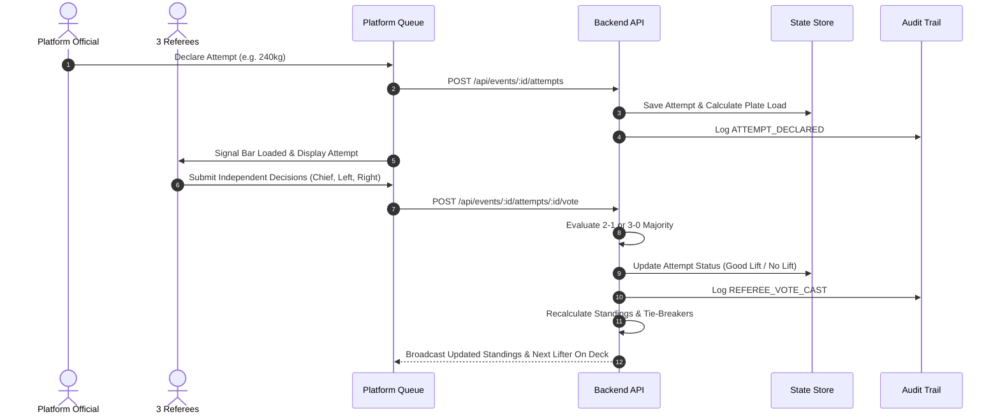

# Ascend System Architecture & Engine Design

This document details the architectural layout, core domain engine separation, data flow models, and immutability guarantees of the **Ascend Competition Standards & Federation Compliance Engine**.

---

## 1. Architectural Principles

1. **Modular Engine Separation**: Rather than scattering federation-specific conditional statements throughout UI components, all core rules, scoring formulas, tie-breakers, attempt queues, and judging logic reside in decoupled, testable TypeScript modules (`src/core/`).
2. **Universal Shared Code**: The exact same scoring and ranking logic is used by the backend API for server-side validation and by the frontend for live preview calculations.
3. **Never Trust Frontend-Only Validation**: Critical competition operations (attempt declarations, weigh-in measurements, referee votes, jury overrides, and finalization) are validated server-side against transactional constraints.
4. **Frozen Rule Snapshots**: When a competition event is initialized or finalized, an immutable rule snapshot is stamped with the effective rulebook edition. Updating Ascend software never retroactively alters past competition results.
5. **Append-Only Audit Trail**: Every mutating operation records previous state, new state, timestamp, actor ID, and role. Finalized records cannot be modified without generating an authorized audit override.

---

## 2. Directory Layout & Subsystem Responsibilities

```
src/
├── core/                              # PURE BUSINESS LOGIC & ENGINES (Shared)
│   ├── types/                         # Strongly-typed schemas (competition, athlete, attempt, judging, ranking, audit)
│   ├── competition-profiles/          # Predefined rule profiles (ascend_open, ipf_inspired, custom)
│   ├── rules-engine/                  # Snapshot freezing, dependency validation, completeness verification
│   ├── scoring-engine/                # Total, Bodyweight Ratio, DOTS, Wilks, Wilks 2020 formulas
│   ├── ranking-engine/                # IPF Category Ranker, Ascend Open Ranker, Individual Lifts, Team Points
│   ├── tie-breaker-engine/            # Multi-tier ordered tie-breaking with justification strings
│   ├── attempt-scheduler/             # Flight grouping, ascending round order, deadlift change rules, bar loader
│   ├── judging-engine/                # 3-referee majority decision matrix & authorized Jury override
│   ├── technical-validation/          # Squat, Bench, Deadlift red-card infraction codes
│   ├── weigh-in/                      # 2-hour window weigh-in evaluation & rack heights
│   ├── equipment-inspection/          # Personal gear checklist & platform clearance
│   ├── official-results/              # 6 official printable sheets & CSV exports
│   └── audit-trail/                   # Immutable event logger
├── server/                            # EXPRESS API & TRANSACTIONAL STORE
│   ├── app.ts                         # REST endpoints & static SPA server
│   └── store.ts                       # Transactional in-memory store with seed data
└── client/                            # REACT 18 + TAILWIND UI
    ├── components/layout/             # Header, event switcher, profile badges
    ├── components/rules-config/       # 15-Section Rules Dashboard with auto-fix
    ├── components/platform/           # Attempt Queue & Colored Bar Loader
    ├── components/referee/            # 3-Referee Virtual Lights (White/Red)
    ├── components/weigh-in/           # Weigh-in session desk & rack heights
    ├── components/leaderboard/        # Standings, tie-break notes, print/CSV exports
    └── components/audit/              # Append-only audit trail viewer
```

---

## 3. Subsystem Breakdown

### 3.1 Rules Engine (`src/core/rules-engine/`)
- **`RulesDependencyValidator`**: Validates configuration integrity across 15 competition sections.
  - Ensures weight category ranking cannot be activated without configured categories.
  - Enforces that IPF mode cannot substitute bodyweight ratio for category total ranking.
  - Validates that 3-referee judging uses a majority threshold $\ge 2$.
  - Generates actionable auto-fix recommendations with direct field patches.
- **`RuleSnapshotManager`**: Freezes the rule configuration object (`Object.freeze`) when events are finalized to prevent retroactive changes.

### 3.2 Scoring Engine (`src/core/scoring-engine/`)
- **`TotalCalculator`**: Sums the best successful attempt for Squat, Bench Press, and Deadlift. Enforces the IPF 3-failures elimination rule (3 failed attempts in any single discipline bombs the lifter out of the total).
- **`BodyweightRatioCalculator`**: Computes $\frac{\text{Total Lifted}}{\text{Official Bodyweight}}$. Strictly guards against calculating final ratios until all required contested lifts are completed, and returns `undefined` for eliminated lifters.
- **`DotsCalculator`**: Computes official IPF DOTS polynomial score:
  $$\text{DOTS} = \frac{\text{Total} \times 500}{A \cdot w^4 + B \cdot w^3 + C \cdot w^2 + D \cdot w + E}$$
  Using the official male and female coefficient tables.
- **`WilksCalculator`**: Computes classic Wilks and Wilks 2020 5th-order polynomial scores.

### 3.3 Tie-Breaker Engine (`src/core/tie-breaker-engine/`)
- **`TieBreakerEngine`**: Evaluates competitors against an ordered sequence of criteria:
  1. `total_weight` (Higher total lifted weight)
  2. `lower_bodyweight` (Lighter official competition bodyweight)
  3. `order_of_achievement` (Earlier attempt timestamp or lower lot number)
  4. `higher_deadlift` / `higher_squat` / `higher_bench`
  5. `bodyweight_ratio`
- **Natural-Language Reason Generator**: Explains the exact justification for every ranking position (e.g. `Rank determined by lower bodyweight: Lighter bodyweight: 82.1 kg vs 82.6 kg`).

### 3.4 Platform Scheduler & Bar Loader (`src/core/attempt-scheduler/`)
- **`FlightManager`**: Distributes competitors into flights (Flight A, Flight B, etc.), adhering to the standard federation limit of 14 lifters per flight.
- **`RoundScheduler`**: Sorts attempts round-by-round in ascending weight order. Ties in attempt weight are broken by lower lot number (lower lot lifts first).
- **`DeadlineTracker`**: Enforces attempt declaration deadlines and validates the Deadlift 3rd Attempt special rule (up to 2 changes permitted before the bar is loaded).
- **`BarLoaderCalculator`**: Computes the optimal plate loading breakdown for platform loaders using a 20kg bar, 5kg collars, and standard calibrated discs (25kg Red, 20kg Blue, 15kg Yellow, 10kg Green, 5kg White, 2.5kg Black, 1.25kg Silver).

### 3.5 Judging Engine (`src/core/judging-engine/`)
- **`JudgingEngine`**: Collects independent votes from the Chief Referee, Left Referee, and Right Referee.
- **Majority Decision Matrix**:
  - 3 White = Good Lift (Unanimous)
  - 2 White, 1 Red = Good Lift (Majority)
  - 2 Red, 1 White = No Lift (Majority)
  - 3 Red = No Lift (Unanimous)
- **Authorized Jury Override**: Preserves original referee decisions while logging the overridden decision, authorized official name, and technical justification in the audit trail.

---

## 4. End-to-End Data Flow



---

## 5. Security & Immutability Architecture

- **Event Locking**: When an event transitions to `finalized` or `locked`, `RuleSnapshotManager.assertCanModifyRules()` rejects subsequent modification requests with HTTP 403.
- **Append-Only Logging**: Audit logs cannot be deleted or updated. Any corrective action generates a new compensating audit log entry.
- **Separation of Scoring from Presentation**: The presentation layer never calculates placings independently; all official standings originate from the validated `CategoryRanker` and `OpenRanker` engines.

